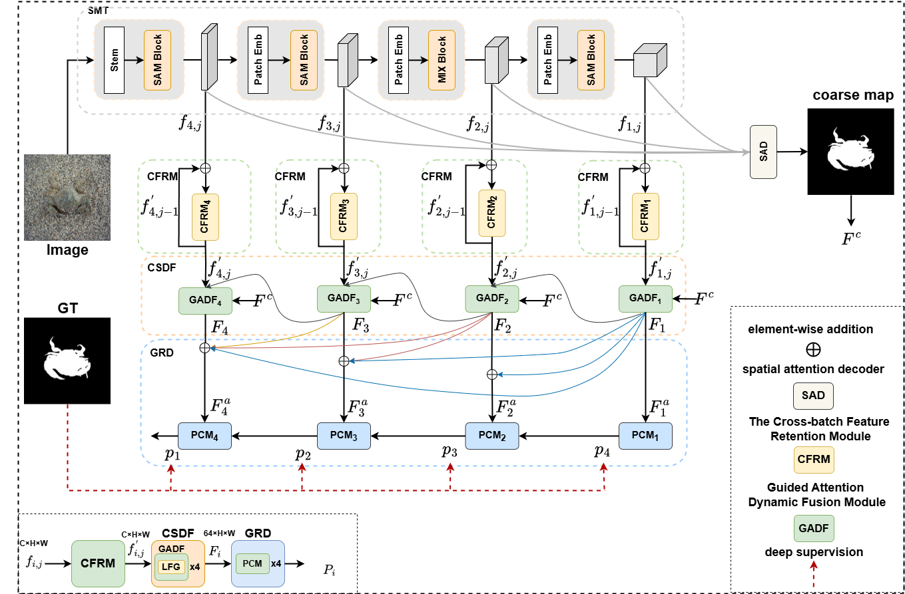
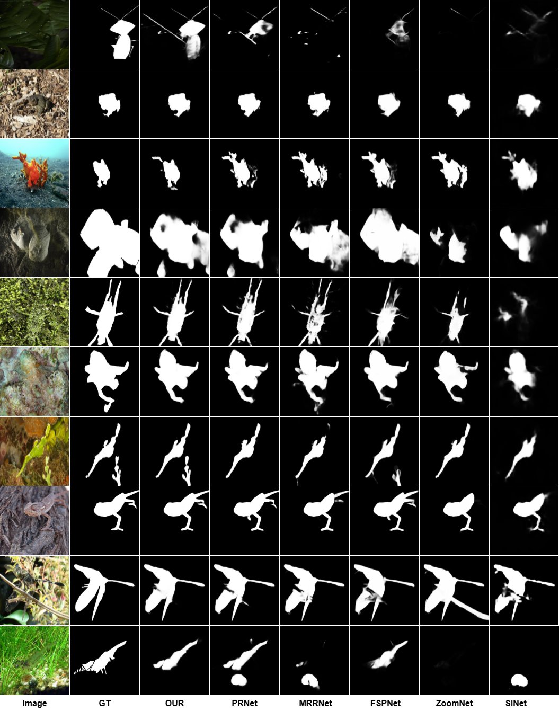

# 📌 RDNet: Dynamic filtering guided transformer with cross-batch feature retention for camouflaged object detection



RDNet extracts multi-scale features with an SMT-Tiny backbone and combines coarse segmentation guidance, attention-based feature fusion, and learnable filtering to predict camouflaged object masks.

## 👉 Note

This repository contains the PyTorch implementation of **RDNet**. Our paper has been accepted by **Pattern Recognition (PR)**. 🎉

**Paper:** [RDNet: Dynamic filtering guided transformer with cross-batch feature retention for camouflaged object detection](https://doi.org/10.1016/j.patcog.2026.114353)  
**Publication:** Pattern Recognition, Volume 180, 2026, Article 114353.

The model is defined in `models/RDNet.py`. Pretrained weights are available through **Baidu Netdisk** using the link below.

## 🌀 Introduction

RDNet processes an input image through four stages:

1. **Multi-scale feature extraction:** SMT-Tiny extracts features at four spatial resolutions.
2. **Coarse estimation and feature mixing:** A coarse estimation module predicts an initial mask, while `ImprovedTimeMixer` processes the backbone features.
3. **Attention and filtering:** Channel attention, spatial attention, and learnable filters refine features through progressive fusion.
4. **Segmentation decoding:** Cross-scale fusion and upsampling produce four segmentation predictions and one coarse prediction for training supervision.

The current implementation uses an input resolution of **384 × 384**. The testing script exports the first segmentation prediction after resizing, Sigmoid activation, and normalization.

## 🧩 Requirements

The following versions were read from the server's `mynet` environment:

| Component | Version |
| --- | --- |
| Operating system | Ubuntu 20.04.6 LTS |
| Python | 3.9.21 |
| PyTorch | 2.6.0+cu118 |
| torchvision | 0.21.0+cu118 |
| PyTorch CUDA build | 11.8 |
| timm | 1.0.15 |

Create an environment and install the pinned project dependencies:

```bash
conda create -n rdnet python=3.9.21 -y
conda activate rdnet
python -m pip install -r request.txt
```

`request.txt` pins the project's direct dependencies to the server versions, including NumPy, Pillow, OpenCV, tensorboardX, and ptflops. It includes the official CUDA 11.8 wheel index for PyTorch; the PyTorch/torchvision pairing matches the [official installation instructions](https://pytorch.org/get-started/previous-versions/#v260).

An NVIDIA GPU with a compatible driver is required because the current entry points use `.cuda()`. `ptflops` is included for the standalone complexity analysis in `models/smt.py`. These versions were inspected and the main packages imported successfully on the server; a fresh environment installation and a full training run have not been verified.

## 📦 Pretrained Weights

Download the pretrained weights from **Baidu Netdisk** and place them in the `weights/` directory.

| Resource | Baidu Netdisk | Extraction code | Local directory |
| --- | --- | --- | --- |
| Pretrained weights (`pth`) | [Download](https://pan.baidu.com/s/1rUZEzfZ0ipkl9U9pStuEvg?pwd=ggsx) | `ggsx` | `weights/` |

```text
weights/
└── smt_tiny.pth
```

The backbone checkpoint must contain a `model` key holding the SMT state dictionary.

## 🗂️ Dataset Preparation

Organize your images and ground-truth masks as follows:

```text
datasets/
├── train_dataset/
│   ├── Imgs/
│   └── GTs/
├── val_dataset/
│   ├── Imgs/
│   └── GT/
└── COD10K/
    └── test/
        ├── Imgs/
        └── GT/
```

Use your designated validation split in `val_dataset/`, or update the validation paths in the training command. Images and masks must correspond after sorting by filename. Training images must use `.jpg`; training masks and test images/masks support `.jpg` and `.png`. The current test loader requires ground-truth masks as well as input images.

## 🚀 Training

Run the following command from the project root after preparing the datasets and backbone weights:

```bash
python My_train.py --gpu_id 0 --trainsize 384 --batchsize 3 --load ./weights/smt_tiny.pth --rgb_root ./datasets/train_dataset/Imgs/ --gt_root ./datasets/train_dataset/GTs/ --test_rgb_root ./datasets/val_dataset/Imgs/ --test_gt_root ./datasets/val_dataset/GT/ --save_path ./checkpoints/
```

Logs and checkpoints are saved to `checkpoints/`, with TensorBoard logs under `checkpoints/summary/`. Reduce `--batchsize` if GPU memory is insufficient. To test your own trained model, pass its checkpoint path through `--checkpoint`.

The defaults in `options_cod.py` still refer to the original machine's `/mnt/...` paths and GPU index `2`. The command above overrides these settings. Keep the input size at `384`, as the model currently contains fixed-size feature fusion operations.

## 🧪 Testing

Place the trained RDNet weights in `weights/MyNet_epoch_best.pth` and run. This checkpoint must contain the complete segmentation model's state dictionary directly, as saved by `model.state_dict()`:

```bash
python My_test.py --gpu_id 0 --testsize 384 --test_path ./ --checkpoint ./weights/MyNet_epoch_best.pth
```

`--test_path` points to the directory containing `datasets/`. The script appends `datasets/COD10K/test/` and saves the predicted masks to:

```text
test_maps(384)/MyNet/datasets/COD10K/test/
```

The outputs are normalized grayscale prediction maps, without binary thresholding. To evaluate another dataset, update `test_datasets` in `My_test.py`.

## 📖 Citation

If you find this work useful, please cite our paper:

```bibtex
@article{wang2026rdnet,
  title={RDNet: Dynamic filtering guided transformer with cross-batch feature retention for camouflaged object detection},
  author={Wang, Jun and Geng, Songxiao and Peng, Jinjia and Liu, Weibin and Liu, Shuaiqi},
  journal={Pattern Recognition},
  pages={114353},
  year={2026},
  publisher={Elsevier}
}
```

## 🖼️ Segmentation Results

Qualitative comparison of RDNet with other methods. From left to right: input image, ground truth (GT), RDNet (OUR), PRNet, MRRNet, FSPNet, ZoomNet, and SINet.

<p align="center">
  <a href="docs/images/result.png">
    
  </a>
</p>
<p align="center">
  <em>Click the figure to view the full-resolution image.</em>
</p>

